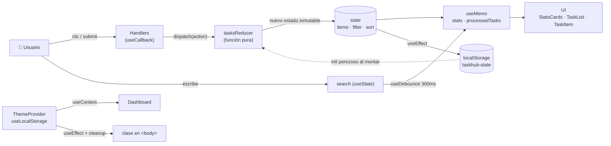
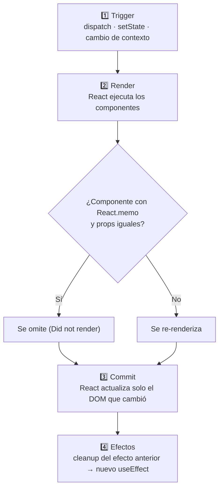

# ✓ TaskHub — Dashboard de Gestión con React Hooks

Práctica Semana 07 (Parte 2) · **Desarrollo de Aplicaciones Web (IS093A)** · UNCP
**Autora:** Jackeline Vivanco Solano

Dashboard de gestión de tareas con estado complejo: agregar, eliminar, completar, filtrar, ordenar y buscar tareas, con tema claro/oscuro y persistencia en `localStorage`.

## 🚀 Ejecutar el proyecto

```bash
npm install
npm run dev     # servidor de desarrollo
npm run lint    # validación ESLint (react-hooks)
```

## 📁 Estructura

```
src/
├── components/
│   ├── StatsCards.jsx     # Tarjetas de estadísticas (React.memo)
│   ├── TaskForm.jsx       # Formulario con useRef + useState local (React.memo)
│   ├── TaskItem.jsx       # Tarea individual (React.memo)
│   ├── TaskList.jsx       # Lista filtrada/ordenada con useMemo
│   └── Toolbar.jsx        # Buscador, filtros y orden
├── contexts/
│   ├── theme.js           # createContext del tema
│   └── ThemeContext.jsx   # ThemeProvider (useLocalStorage + useEffect)
├── hooks/
│   ├── useTasksReducer.js # Reducer: ADD, REMOVE, TOGGLE, FILTER, SORT, CLEAR_COMPLETED
│   ├── useLocalStorage.js # Hook personalizado: estado sincronizado con localStorage
│   └── useDebounce.js     # Hook personalizado: retraso de búsqueda
├── utils/
│   └── procesarTareas.js  # Función pura de filtrado y ordenamiento
├── App.jsx                # Dashboard + ThemeProvider
└── main.jsx               # StrictMode
```

## 🔄 Diagrama de flujo de estado



## 🔁 Ciclo de render



> En desarrollo, **StrictMode** monta → desmonta → monta cada componente para verificar que los efectos tengan cleanup correcto.

## 🧠 Justificación técnica de cada hook (¿por qué no `useState` simple?)

| Hook                                  | Dónde                                                   | ¿Por qué este y no `useState` simple?                                                                                                                                                                                                                                         |
| ------------------------------------- | ------------------------------------------------------- | ----------------------------------------------------------------------------------------------------------------------------------------------------------------------------------------------------------------------------------------------------------------------------- |
| **useReducer**                        | `App.jsx` + `useTasksReducer.js`                        | El estado tiene varios sub-valores relacionados (`items`, `filter`, `sort`) y la lógica de actualización depende del estado anterior. El reducer centraliza todas las transiciones en una función pura, inmutable y fácil de probar, en lugar de varios `setState` dispersos. |
| **useState**                          | `TaskForm`, buscador                                    | Solo para estado de UI **local y simple** (texto del input, prioridad seleccionada, texto de búsqueda) que no necesita compartirse.                                                                                                                                           |
| **useContext**                        | `ThemeContext`                                          | El tema lo necesitan varios componentes. Con contexto se evita el _prop drilling_. Se usa solo para el tema porque cambia poco; las tareas (que cambian seguido) **no** van en contexto para no re-renderizar a todos los consumidores.                                       |
| **useEffect**                         | `ThemeContext`, `App`, `useLocalStorage`, `useDebounce` | Sincroniza React con sistemas externos: la clase del `<body>`, `localStorage`, el evento `storage` y los timers. Todos tienen **cleanup** (`classList.remove`, `removeEventListener`, `clearTimeout`) para evitar memory leaks.                                               |
| **useMemo**                           | `TaskList` (filtrar/ordenar), `App` (stats)             | Filtrar y ordenar se recalcula **solo** si cambian `tasks`, `filter`, `sort` o `search`. Las estadísticas solo dependen de `items`, así que no se recalculan al escribir en el buscador o cambiar el tema.                                                                    |
| **useCallback**                       | `handleAdd`, `handleToggle`, `handleRemove`             | Estas funciones se pasan como props a hijos con `React.memo`. Sin `useCallback`, cada render crea funciones nuevas y `memo` dejaría de funcionar. No se aplicó a `onFilter`/`onSort` porque `Toolbar` no usa `memo` (evitamos el _overuse_).                                  |
| **useRef**                            | `TaskForm`                                              | Acceso directo al `<input>` para el auto-focus al montar y después de agregar una tarea, **sin provocar re-renders**.                                                                                                                                                         |
| **useLocalStorage** _(personalizado)_ | `ThemeContext`                                          | Encapsula y reutiliza el patrón "estado + lectura inicial + guardado + sincronización entre pestañas". Tiene la misma API que `useState`: `[value, setValue]`.                                                                                                                |
| **useDebounce** _(personalizado)_     | Buscador                                                | Evita filtrar en cada tecla: la lista se actualiza 300 ms después de que el usuario deja de escribir. Reutilizable en cualquier input.                                                                                                                                        |

## ✅ Validación

1. **ESLint:** `npm run lint` sin warnings de `react-hooks/exhaustive-deps`.
2. **Profiler:** al completar una tarea, antes de optimizar se re-renderizaban todos los `TaskItem`, `TaskForm` y `StatsCards`. Después de `React.memo` + `useCallback` + `useMemo`, solo se re-renderiza la tarea modificada.
3. **Cleanup:** el `<body>` nunca tiene `light` y `dark` a la vez; el listener `storage` se elimina al desmontar; el timer del debounce se cancela en cada tecla.

## 📏 Reglas de Hooks aplicadas

- Los hooks se llaman solo en el nivel superior, nunca dentro de loops, condiciones ni funciones anidadas.
- Solo se usan en componentes funcionales o en hooks personalizados (prefijo `use`).
- Todos los arrays de dependencias están completos (validados por ESLint).

## 👥 Roles técnicos

| Rol                             | Responsabilidad cubierta                                                |
| ------------------------------- | ----------------------------------------------------------------------- |
| Arquitecto de Estado            | `useReducer`, acciones, reducer puro e inmutable                        |
| Ingeniero de Efectos & Contexto | `useEffect`, `useContext`, sincronización con storage, cleanup          |
| Optimizador de Rendimiento      | `useMemo`, `useCallback`, `useRef`, `React.memo`, análisis con Profiler |
| QA & Hook Validator             | Reglas de Hooks, ESLint, documentación, hooks personalizados            |
